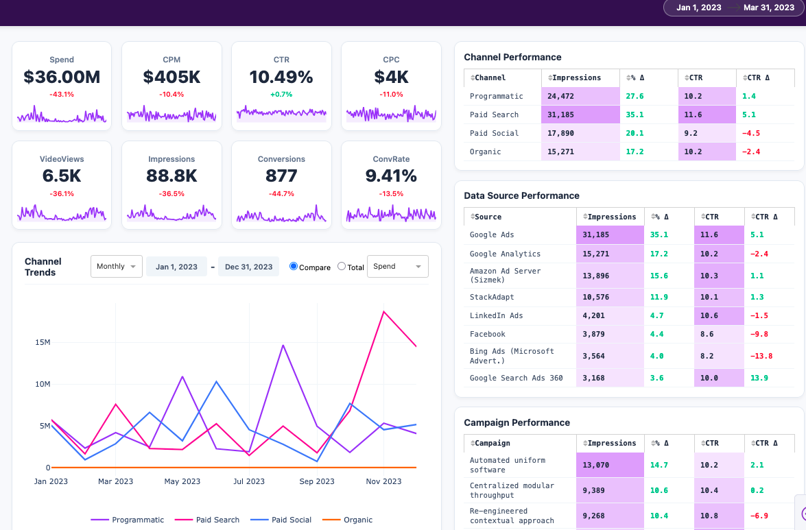

# Algorithmic Marketing Dashboard Generator

A full-stack data visualization project that simulates realistic, high-volatility marketing data using **Stochastic Jump Diffusion models** and visualizes it via a custom-built **Dash/Plotly** web application.



## The "Why"
Standard "dummy data" (random integers) fails to capture the nuances of real-world marketing performance—seasonality, budget shocks, and channel correlation. 

This project creates a **Synthetic Data Engine** that models market behavior using financial mathematics (Brownian Motion + Poisson Jumps) to generate datasets that "tell a story" (e.g., a Super Bowl ad spike, a budget slash, or organic growth trends). The data is then served to a responsive, production-grade dashboard.

## Key Features

### 1. Stochastic Data Generation (The Engine)
Instead of `random.randint`, the data generator uses:
* **Geometric Brownian Motion (GBM):** For standard organic trend deviation.
* **Jump Diffusion Process:** To simulate massive "shocks" (e.g., 400% spend spikes for campaign launches).
* **Regime Switching:** Distinct behaviors for different periods (e.g., "Q1 Slump" vs. "Q4 Holiday Push").
* **Adstock / Decay Modeling:** Impressions and Clicks don't drop to zero instantly; they decay over a 7-day moving average to simulate brand awareness carryover.

### 2. The Dashboard (The Interface)
Built with **Python Dash & Plotly** (no drag-and-drop tools), featuring:
* **Custom CSS Layout:** A responsive 55/45 split layout with a "glassmorphism" inspired top bar.
* **Conditional Formatting:** Pandas-driven heatmaps for CTR and Impressions in the data tables.
* **Dynamic Sparklines:** Micro-charts embedded in KPI cards to show daily volatility at a glance.
* **Cross-Filtering:** Date pickers and aggregation toggles (Daily/Monthly) that trigger real-time Pandas callbacks.

## Tech Stack
* **Language:** Python 3.9+
* **Data Processing:** Pandas, NumPy (Vectorized operations for simulation)
* **Visualization:** Plotly, Dash, Dash HTML/Core Components
* **Styling:** Custom CSS, Flexbox, Grid Layouts

## Installation & Usage

1. **Clone the repository**
   ```bash
   git clone https://github.com/ArsVie/Algorithmic-Marketing-Dashboard-Generator
   cd Algorithmic-Marketing-Dashboard-Generator
   ```
2. **Create a virtual environment (Recommended)**
```bash
python -m venv venv
# Windows:
venv\Scripts\activate
# Mac/Linux:
source venv/bin/activate
```

3. **Install dependancies**
```bash
pip install -r requirements.txt
```

4. **Run the applicaction**
```bash
python app.py
```

5. **Access the Dashboard**
   Open your web browser and navigate to: http://127.0.0.1:8050
